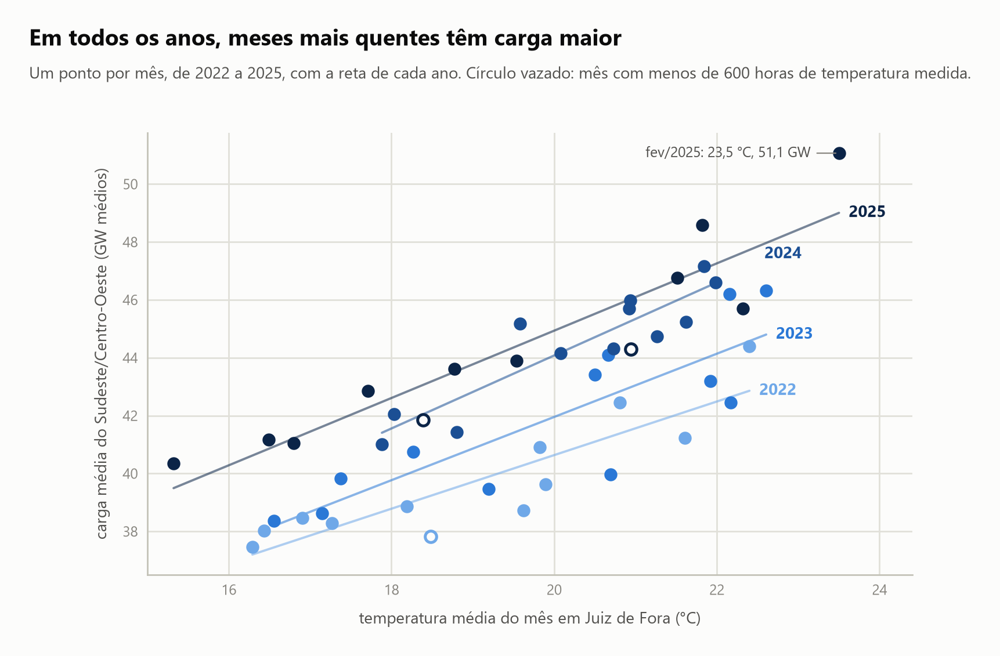
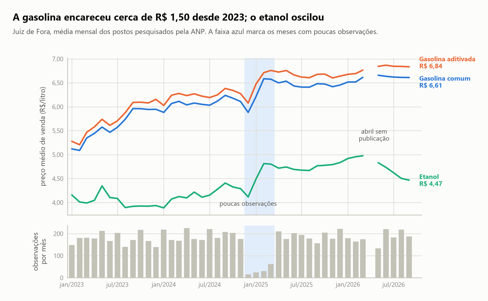

# P07. Coletor de dados via API

**Nº 7 de 37 na ordem de execução.** ID do projeto: P07.

**Cursos da Alura a fazer antes deste projeto (todos os que caem aqui na ordem das 4 carreiras):**
- AD/N2-03 - Python e APIs: biblioteca Requests
- AD/Base-04 - Excel: domine o editor de planilhas (curso base, sem projeto próprio)

Um coletor que busca dados públicos brasileiros, trata as falhas que aparecem no caminho e guarda um histórico que posso reaproveitar em outros projetos. Escolhi três fontes que cobrem o mesmo recorte, Juiz de Fora entre 2022 e 2026: a carga de energia do sistema elétrico (ONS), o clima de uma estação meteorológica (INMET) e o preço de gasolina e etanol nos postos (ANP). Nenhuma entrega os dados do mesmo jeito, e o que o projeto mostra é como cada uma exigiu um tratamento diferente.

## Os dados

O portal de dados abertos do ONS (<https://dados.ons.org.br>) usa CKAN. A API devolve o catálogo, e os números ficam em arquivos CSV hospedados num armazenamento da Amazon, um por ano. Uso a carga diária de energia por subsistema (Norte, Nordeste, Sul e Sudeste/Centro-Oeste), em MW médios, de 01/01/2000 a 09/10/2026 na coleta de 11/10/2026. São 39.116 linhas.

No INMET, a API (`apitempo.inmet.gov.br`) lista as estações, mas a rota de medições respondeu 204, sem conteúdo, em todos os testes. Os dados vêm dos arquivos históricos anuais do portal (<https://portal.inmet.gov.br/dadoshistoricos>), zips de 80 a 137 MB com um CSV por estação. Extraio só a A518, de Juiz de Fora, de 2022 a 2025: medições horárias de temperatura, pressão, umidade, vento, radiação e chuva, 35.064 linhas.

Na ANP não há API. Os preços de combustível (<https://www.gov.br/anp/pt-br/centrais-de-conteudo/dados-abertos>) são CSVs listados numa página, que o coletor lê para achar os links. Uso os arquivos mensais de gasolina e etanol de janeiro de 2023 a setembro de 2026 (44 arquivos de cerca de 8 MB, com todos os postos do país) e guardo só o município de Juiz de Fora: 7.545 registros de gasolina comum, aditivada e etanol.

Os arquivos baixados e os históricos consolidados ficam em `data/`, fora do Git (ver `.gitignore`).

## O coletor

Cada fonte pediu uma solução diferente.

No ONS, pedi um ano que não existe e o servidor respondeu 404 com uma mensagem de erro em XML, que o `requests` entregou como se fosse conteúdo. Gravar isso num `.csv` contaminaria o histórico, então toda chamada confere o status. Erro 4xx desiste na hora, porque repetir o pedido dá o mesmo erro, e 5xx, tempo esgotado e conexão derrubada tentam de novo com espera crescente. O coletor é incremental: compara o tamanho do arquivo local com o que o catálogo anuncia e só baixa o que mudou.

No INMET, os zips têm de 80 a 137 MB, e uma queda de conexão no meio de um deles desperdiçaria minutos de download. O servidor aceita o cabeçalho `Range`, então o download retoma de onde parou e confere o tamanho final contra o anunciado. O coletor abre só o CSV da estação dentro do zip, valida as 24 linhas por dia e só então apaga o zip.

Na ANP, o `HEAD` é bloqueado (403), então o download é o simples. Os nomes dos arquivos de 2026 não seguem o padrão dos anos anteriores, e a chave de cada arquivo vem da pasta e dos dois primeiros dígitos do nome. O coletor filtra o município e guarda um arquivo por mês.

## Os gráficos

Os dois gráficos usam o recorte que as fontes têm em comum. O primeiro pergunta se a carga elétrica acompanha o calor: um ponto por mês, com a temperatura média de Juiz de Fora e a carga média do Sudeste/Centro-Oeste, de 2022 a 2025. A correlação nos 48 meses é 0,78 e, dentro de cada ano, entre 0,85 e 0,93. As retas de cada ano têm inclinação parecida, entre 0,93 e 1,26 GW a mais por grau. Para a mesma temperatura, 2022 fica abaixo de 2023 e 2023 abaixo de 2024, então parte do aumento da carga não vem do calor. O ponto mais alto é fevereiro de 2025, com 23,5 °C e 51,1 GW.



O segundo mostra o preço médio mensal por produto, com o número de observações de cada mês embaixo, porque ele varia muito. A gasolina comum vai de R$ 5,12 em janeiro de 2023 a R$ 6,61 em setembro de 2026, cerca de R$ 1,50 a mais. O etanol oscila entre R$ 3,89 e R$ 4,98 e, depois de chegar a R$ 4,98 em março de 2026, cai para R$ 4,47 em setembro, enquanto a gasolina fica perto de R$ 6,60. O salto de preço entre o fim de 2024 e o início de 2025 cai justamente nos quatro meses de poucas observações (15, 24, 30 e 62, contra uma mediana mensal de 178), e os dados não permitem separar aumento real de efeito da amostra pequena.



## Resultado

O coletor produziu três históricos prontos para reuso: `historico_carga_ons.csv`, `historico_inmet_A518.csv` e `historico_anp_jf.csv`. A validação de cada um achou problemas que eu não teria visto sem conferir.

| Fonte | Registros | Sem valor | % sem valor | Período |
|---|---|---|---|---|
| ONS carga diária | 39.116 | 12 | 0,03 | 01/01/2000 a 09/10/2026 |
| INMET A518 horário | 35.064 | 1.201 | 3,43 | 01/01/2022 a 31/12/2025 |
| ANP gasolina e etanol | 7.545 | 0 | 0,00 | 13/01/2023 a 28/09/2026 |

No ONS, o arquivo de 2013 tinha uma linha extra do Sul às 00:00:01, sem valor, que removi, e há três dias inteiros sem dado (01/12/2013, 01/02/2014 e 09/04/2015) que mantive como vazios. No INMET, a temperatura falta em 386 horas de julho de 2022 e em 790 horas de março a maio de 2025. Na ANP, a coleta no município cai a 15 a 62 registros por mês de dezembro de 2024 a março de 2025, e abril de 2026 não está na página.

## Limitações

Não sei a causa de nenhuma das lacunas e não afirmo. Não preencho nem interpolo os vazios: zero ou média seria um valor que a fonte não publicou. As médias mensais dos meses afetados se baseiam em menos dados, e isso está marcado nos gráficos.

Só o ONS usa uma API de verdade, e só para descobrir os arquivos. A API do INMET serviu para listar estações e a da ANP não existe. A sinopse inicial previa paginação e limite de requisições, e nenhuma das três fontes exigiu isso. O que pesou foi o tamanho dos downloads e o formato de cada fonte.

O recorte é pequeno: uma estação meteorológica, um município de preços e a carga de uma região inteira. A correlação entre temperatura e carga não é causa, porque a estação do ano e o crescimento do consumo mudam junto, e a temperatura é de um ponto só. A radiação global do INMET tem 44% de horas vazias, concentradas à noite, e não a uso. Os preços da ANP são de postos pesquisados, não de todos, e o volume de coleta no município muda de um período para outro.

O ano de 2022 ficou fora dos preços da ANP, porque os arquivos dele estão em zip e com nome fora do padrão. O INMET de 2026 também ficou fora: o zip existe, mas é de um ano incompleto, e baixar 137 MB a cada atualização não valia o custo. O critério incremental do ONS (tamanho do arquivo) é uma aproximação, e o do INMET e da ANP (arquivo já existe) assume que os meses passados não são corrigidos depois.

## Como rodar

```bash
pip install -r requirements.txt
jupyter notebook notebooks/P07_coletor_dados_api.ipynb
```

A primeira execução baixa tudo (27 arquivos do ONS, 4 zips do INMET de uns 100 MB e 44 arquivos da ANP) e leva de 30 a 60 minutos, conforme a velocidade dos servidores. Nas seguintes, só baixa o que falta ou mudou. O notebook importa `notebooks/estilo.py`, que guarda só a aparência dos gráficos. As figuras são salvas em `images/`.
